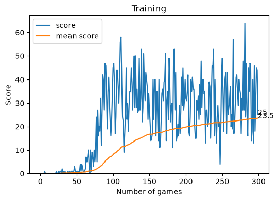

# ai_snake

A snake game that teaches itself to play with **Deep Q-Learning** (PyTorch + pygame).


*The shipped model playing (recorded with `uv run ai-snake record`). It went from
random moves to a mean score of ~23 and a record of 64 in 300 games (~2.5 min):*



## Quick start

You need [uv](https://docs.astral.sh/uv/getting-started/installation/). It also
installs the right Python (3.12, see `.python-version`).

```bash
git clone <this repo> && cd ai_snake
uv sync                    # creates .venv with all dependencies

uv run ai-snake play       # watch the pretrained agent play (opens a window)
uv run ai-snake train      # train your own agent from scratch, with a live plot
```

## Commands

| Command | What it does |
| --- | --- |
| `uv run ai-snake train` | Train from scratch. Shows the game and a live score plot. Saves the best model to `model/model.pth` and the curve to `model/training.png`. Stop with `Ctrl+C`. |
| `uv run ai-snake train --headless --games 300` | Same, without any window (fast, works over SSH). |
| `uv run ai-snake play` | Watch a trained agent play. Uses `model/model.pth` if you trained one, else the pretrained model. |
| `uv run ai-snake record` | Record a game into `assets/demo.gif`. No window or display needed. |

Useful options (see `uv run ai-snake <command> --help`):

- `--games N` stop training after N games
- `--speed FPS` game speed in the window (`0` = as fast as possible)
- `--device auto|cuda|mps|cpu` (train) where the network runs; `auto` picks a GPU if there is one
- `--seed N` reproducible runs
- `--model PATH` use or save a different model file
- `--min-score N` (record) replay until a game reaches this score

## GPU

On Linux, `uv sync` installs PyTorch with CUDA, so `train` runs on an NVIDIA GPU
automatically (`Training on cuda`). macOS uses Apple's MPS, and anything else
falls back to the CPU.

The network is tiny (11 → 256 → 3) and learns from one step at a time, so a GPU
does not make training faster. It is usually slower, because it pays a kernel
launch per frame. For the quickest training use `--device cpu`. `play` and
`record` always run on the CPU.

## How it works

- **State** (11 values): danger straight / right / left, current direction, and
  whether the food is left / right / up / down of the head.
- **Action**: go straight, turn right or turn left.
- **Reward**: +10 for food, −10 for dying, 0 otherwise.
- **Model**: an MLP that predicts a Q-value per action, trained with the Bellman
  update `Q = r + γ · max Q(next state)`. It learns from every step and from
  replayed batches of past experience after each game. Early on it explores with
  random moves.

```
src/ai_snake/
├── game.py       # the snake environment (pygame, can render headless)
├── model.py      # Q-network + trainer
├── agent.py      # state encoding, train and play loops
├── record.py     # GIF recorder
├── plot.py       # training curve
├── cli.py        # `ai-snake` command
└── pretrained/   # model shipped with the repo
```

## Development

```bash
uv run pytest            # smoke tests (incl. a GPU test when CUDA is available)
uv run ruff check .      # lint
uv run ruff format .     # format
```

To refresh the demo media after retraining:

```bash
uv run ai-snake train --headless --games 300 --seed 42 \
    --model src/ai_snake/pretrained/model.pth --plot-file assets/training.png
uv run ai-snake record --min-score 30 --max-frames 900
```

## Credits

Based on this video tutorial: https://www.youtube.com/watch?v=L8ypSXwyBds
