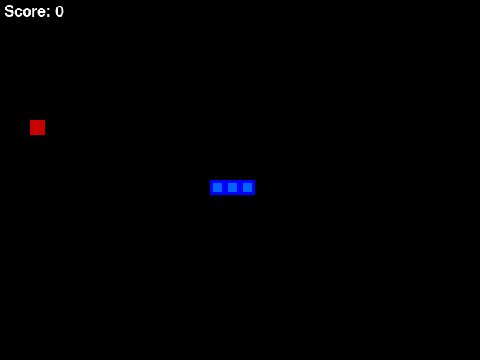

# AI Snake

A snake game that teaches itself to play with **Deep Q-Learning** (PyTorch + pygame).



It starts with random moves and, within 300 games (~2.5 minutes), reaches a
mean score of ~23 and a record of 64:


## Quick start

You need [uv](https://docs.astral.sh/uv/getting-started/installation/).

```bash
git clone https://github.com/EagleEyeElite/ai_snake.git && cd ai_snake
uv sync

uv run ai-snake play       # watch the pretrained agent play
uv run ai-snake train      # train your own agent from scratch
```

## Credits

Based on this [video tutorial](https://www.youtube.com/watch?v=L8ypSXwyBds).
